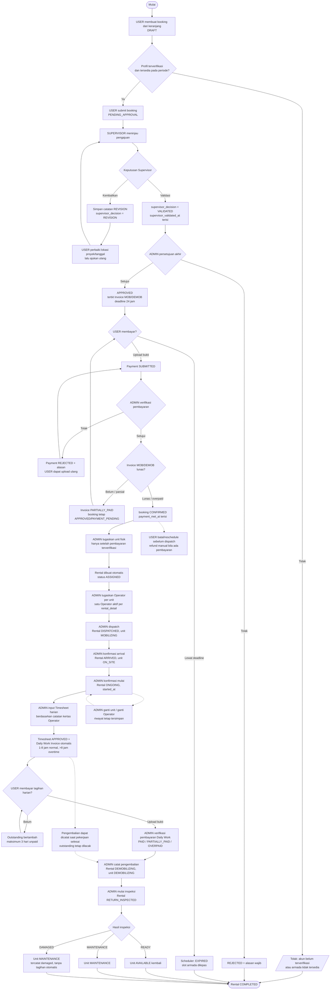

# Activity Diagram — Booking sampai Rental Selesai (Revisi Poin 4)

Dasar alur: `SubmitBookingAction`, `ValidateBookingAction`, `ReturnBookingAction`, `UpdateBookingAction`, `ApproveBookingAction`, `RejectBookingAction`, `VerifyPaymentAction`, `AssignBookingUnitsAction`, `AssignRentalOperatorAction`, `TransitionRentalAction`, `CreateTimesheetAction`, `CreateDailyInvoiceAction`, `InspectRentalAction`, scheduler `bookings:expire` / `invoices:expire`.

## Diagram utama (Mermaid)

## Penjelasan singkat
- **Validasi Supervisor adalah gerbang wajib**: `ApproveBookingAction`/`RejectBookingAction` menolak (409) booking yang belum `VALIDATED`.
- **Invoice MOB/DEMOB** hanya terbit saat `APPROVED`; Total = MOB + DEMOB (bukan tarif sewa).
- **Pembayaran parsial tidak mengonfirmasi booking**: `CONFIRMED` hanya saat invoice MOB/DEMOB lunas/overpaid; parsial tetap `APPROVED`/`PAYMENT_PENDING`.
- **Penugasan unit dan Operator** di backend mensyaratkan `payment_met_at` (pembayaran terverifikasi) dan unit `is_current`.
- **Timesheet bukan milik Operator digital**: Admin input dari kertas operator; tersimpan langsung `APPROVED` dan memicu Daily Work Invoice.
- **Rental** berjalan `ASSIGNED → DISPATCHED → ARRIVED → ONGOING → DEMOBILIZING → RETURN_INSPECTED`, lalu selesai lewat inspeksi (bukan transisi `COMPLETED` langsung).
- **Booking expired / ditolak** adalah terminal dan melepaskan slot armada.
- **Payment ditolak** tidak menghapus data; user dapat upload bukti baru dan invoice deadline tidak di-reset.
- **Daily Work Invoice** diverifikasi Admin seperti invoice lain. Pengembalian unit dapat dicatat saat pekerjaan selesai; outstanding harian tetap dipantau (`max_outstanding_days=3`) dan tidak menjadi gate transisi rental di implementasi saat ini.
- **Inspeksi** adalah langkah penutup: `InspectRentalAction` mengubah rental menjadi `COMPLETED` dan menentukan unit `AVAILABLE` atau `MAINTENANCE`.

## Aturan yang diterapkan diagram
- MOB = jarak rute satu arah × tarif/km; DEMOB = jarak rute satu arah × tarif/km; Total MOB/DEMOB = MOB + DEMOB (snapshot pada `booking_details`).
- Tarif rental per jam **hanya** dipakai untuk Daily Work Invoice dari Timesheet aktual.
- Routing Mapbox **belum tervalidasi live** (token + data pool belum tersedia) — diagram menampilkan konfigurasi sebagai prasyarat, bukan hasil tervalidasi.
