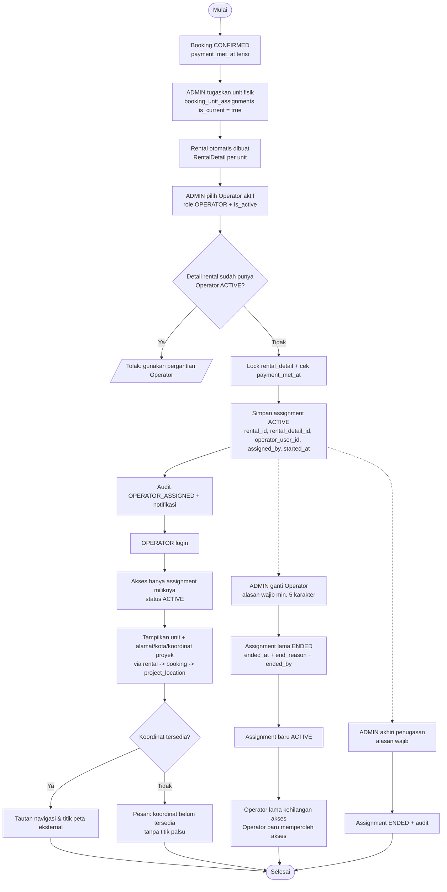

# Activity Diagram — Penugasan & Akses Operator (Revisi Poin 4)

Dasar: `AssignRentalOperatorAction`, `AdminRentalOperatorController`, `OperatorAssignmentController`, `RentalOperatorAssignmentPolicy`, `rental_operator_assignments`.

Aturan keamanan:
- Endpoint `GET /operator/*` memakai middleware `role:OPERATOR`.
- Detail assignment memakai `RentalOperatorAssignmentPolicy::view` = pemilik **dan** `status=ACTIVE`; menukar ID assignment/rental/project_location Operator lain → 403.
- Daftar & dashboard selalu `where('operator_user_id', auth id)`.
- Operator tidak dapat input/validasi Timesheet (`TimesheetPolicy::create/validate` = ADMIN only).
