# Use Case Diagram — RAFA Rental (Revisi Poin 4)

Diagram ini diturunkan dari implementasi aktual: `UserRole` enum, `RequireRole` middleware, `BookingPolicy`, `RentalOperatorAssignmentPolicy`, `AppServiceProvider::registerGates()`, dan `backend/routes/api.php`. Bukan dari asumsi dokumentasi.

## Diagram (Mermaid)

```mermaid
flowchart LR
  U((USER))
  S((SUPERVISOR))
  A((ADMIN))
  O((OPERATOR))
  W((OWNER))

  subgraph SISTEM["Sistem RAFA Rental"]
    direction TB

    subgraph AKUN["Autentikasi & Akun"]
      UC01["Registrasi / Login"]
      UC02["Kelola profil & verifikasi akun"]
    end

    subgraph KATALOG["Katalog & Rekomendasi"]
      UC03["Lihat katalog & detail alat"]
      UC04["Minta rekomendasi alat"]
      UC05["Kelola lokasi proyek"]
    end

    subgraph TRANSAKSI["Keranjang & Booking"]
      UC06["Kelola keranjang sewa"]
      UC07["Ajukan booking (DRAFT -> PENDING_APPROVAL)"]
      UC08["Perbaiki & ajukan ulang booking (revisi Supervisor)"]
      UC09["Batalkan / ajukan reschedule booking"]
      UC37["Lihat Timesheet & tandatangani (read-only)"]
    end

    subgraph VALIDASI["Validasi Supervisor"]
      UC10["Lihat antrean booking menunggu validasi"]
      UC11["Validasi booking (valid)"]
      UC12["Kembalikan booking untuk perbaikan + catatan"]
    end

    subgraph APPROVAL["Persetujuan & Pembayaran"]
      UC13["Setujui booking (final approval)"]
      UC14["Tolak booking + alasan"]
      UC15["Terima invoice MOB/DEMOB"]
      UC16["Upload bukti pembayaran"]
      UC17["Verifikasi / tolak pembayaran"]
      UC18["Lihat tagihan, outstanding, refund & notifikasi"]
    end

    subgraph OPERASIONAL["Penugasan & Eksekusi Rental"]
      UC19["Tugaskan unit fisik ke booking"]
      UC20["Tugaskan / ganti / akhiri Operator"]
      UC21["Eksekusi rental: dispatch, arrival, ongoing, return"]
      UC22["Input Timesheet harian (auto Daily Work Invoice)"]
      UC23["Inspeksi unit: READY / MAINTENANCE / DAMAGED"]
    end

    subgraph OPERATORUC["Portal Operator"]
      UC24["Lihat dashboard & penugasan aktif miliknya"]
      UC25["Lihat detail rental, unit & lokasi proyek"]
      UC26["Navigasi ke koordinat lokasi proyek"]
    end

    subgraph ADMINUC["Administrasi & Laporan"]
      UC27["Kelola master data alat & pool armada"]
      UC28["Kelola tarif / pricing master"]
      UC29["Kelola invoice, refund, outstanding, bank account"]
      UC30["Verifikasi akun, kelola akun & role (USER / SUPERVISOR / OPERATOR)"]
      UC31["Laporan operasional & finansial"]
      UC32["Kelola CMS landing page"]
    end

    subgraph OWNERUC["Monitoring Owner"]
      UC33["Dashboard eksekutif & laporan pendapatan"]
      UC34["Lihat audit trail"]
      UC35["Setujui refund (existing)"]
      UC36["Nonaktifkan akun pengguna (existing)"]
    end
  end

  S --> UC01
  A --> UC01
  O --> UC01
  W --> UC01

  U --> UC01
  U --> UC02
  U --> UC03
  U --> UC04
  U --> UC05
  U --> UC06
  U --> UC07
  U --> UC08
  U --> UC09
  U --> UC15
  U --> UC16
  U --> UC18
  U --> UC37

  S --> UC10
  S --> UC11
  S --> UC12

  A --> UC13
  A --> UC14
  A --> UC17
  A --> UC19
  A --> UC20
  A --> UC21
  A --> UC22
  A --> UC23
  A --> UC27
  A --> UC28
  A --> UC29
  A --> UC30
  A --> UC31
  A --> UC32

  O --> UC24
  O --> UC25
  O --> UC26

  W --> UC33
  W --> UC34
  W --> UC35
  W --> UC36
```

> Catatan: **OWNER tidak memiliki akses approve/reject booking.** Final approval adalah `ADMIN`-only (`Gate 'approve-booking'`, `BookingPolicy::approve/reject`, middleware `role:ADMIN` pada route approve/reject). OWNER hanya monitoring/laporan, approve refund, dan deactivate user sesuai permission existing.

## Pemetaan aktor → implementasi (dasar diagram)

| Aktor | Hak akses aktual (sumber) |
|---|---|
| USER | `BookingPolicy` (create/submit/view own), cart, project-locations, `GET/POST /recommendations*` (scoped own), `GET /timesheets` (read-only own), `POST /payments`, `GET /invoices`, `GET /refunds`, `GET /notifications` |
| SUPERVISOR | Route `role:SUPERVISOR` → `/supervisor/bookings*`; `BookingPolicy::view` (hanya PENDING_APPROVAL), `BookingPolicy::validate` |
| ADMIN | booking approve/reject (wajib `VALIDATED`, route `role:ADMIN`), assign units, `Operators` + operator-assignments, rentals transitions + ready/inspection, timesheets write/validate, invoices/payments verification, refunds, master data (route `role:ADMIN`/`ADMIN,OWNER`), pricing, CMS, user verification + role update |
| OPERATOR | Route `role:OPERATOR` → `/operator/dashboard`, `/operator/assignments`, `/operator/assignments/{assignment}`; `RentalOperatorAssignmentPolicy::view` (pemilik + status ACTIVE) |
| OWNER | Gates `view-owner-dashboard`, `view-revenue-reports`, `view-audit-logs`, `approve-refund`, `deactivate-user`; user list & monitoring reports; **tidak ada approve/reject booking**, tidak ada operasional unit/Operator/Timesheet |

## Use case yang TIDAK diberikan ke Supervisor/Operator
- Supervisor tidak memiliki `assignUnits`, `approve`, `reject`, verifikasi pembayaran, input Timesheet, atau akses master data.
- Operator tidak memiliki approval, penugasan unit, input Timesheet (`TimesheetPolicy::create` = ADMIN only), pembayaran, atau master data.
